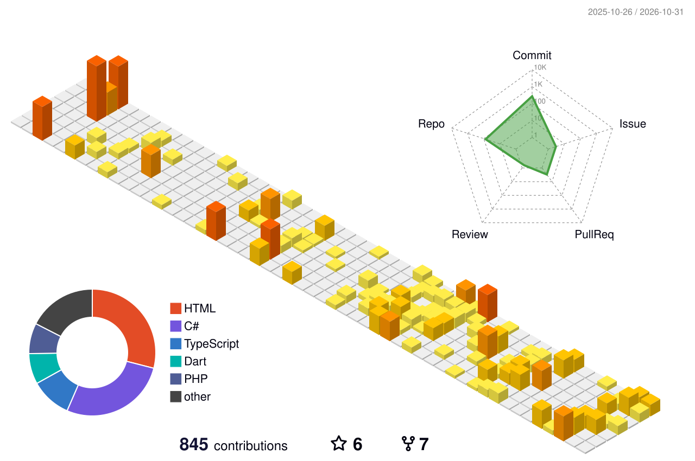

 

### 🏆 Achievements

---

## 🚀 About Me

  
   <b>Software Engineer × Poet</b> · Code · Poetry · Books · Security

 

| | |
|--|--|
| 🦀 | Building **[Pixora Studio](https://github.com/mohammad-sheikh-shahinur-rahman/Pixora-Studio-Professional-Photo-Editor)** — a native, GPU-accelerated professional photo editor written *entirely in Rust*: true PSD fidelity, no subscriptions, no webviews, no telemetry |
| 📚 | **36+ published books** — poetry 🔔, cybersecurity & pentesting 🛡️, software engineering 💻 — published by *আমাদের সমাজ প্রকাশনী* (24 of them featured on [Rokomari](https://www.rokomari.com/book/author/126602/mohammad-sheikh-shahinur-rahman)) |
| 🎓 | BSc in Software Engineering — **[HKUST](https://www.hkust.edu.hk/)** |
| 🛡️ | Digital forensics & bug-bounty researcher — evidence-driven by training, imagination-driven by craft |
| 🌍 | Free · open source · offline-first — technology that belongs to everyone |
| 🎂 | May 15 · 📍 Kishoreganj, Bangladesh |

## ✒️ Pen & Pixels

  

## 🧰 Tech Stack

**⚡ Rust is my main weapon** — systems programming, GPU pipelines (wgpu), file-format parsing (PSD/ICC) and a zero-crash security model.

## 🌟 [Pixora Studio](https://github.com/mohammad-sheikh-shahinur-rahman/Pixora-Studio-Professional-Photo-Editor) — Flagship

  

<b>Professional Photo Editing. Free for Everyone.</b> 
A native, GPU-accelerated photo editor written <b>entirely in Rust</b> — zero Electron, zero webviews.  

- 🎛️ **Familiar by design** — the menus, shortcuts and dockable panels professionals already know
- ⚡ **Native & lightning fast** — pure Rust + GPU compositor on wgpu, tile-parallel, copy-on-write memory
- 🗂️ **True PSD fidelity** — layered PSD/PSB in and out: blend modes, masks, smart objects
- 🖼️ **Color-managed precision** — full ICC workflows, 8/16/32-bit, RGB·Gray·CMYK·Lab
- 🔒 **100% offline & free** — no accounts, no cloud, no telemetry. Your machine, your work.
- 🤖 **Automation-first** — every feature is a command: headless CLI, Photoshop-compatible Actions, MCP for agents

   
  Native GPU composition with live type, Curves &amp; Vibrance adjustment layers, and drop-shadow layer styles.

## 🧩 More Projects

| | |
|--|--|
| 🎬 **[Recova Studio](https://github.com/mohammad-sheikh-shahinur-rahman/Recova-Studio)** · `TypeScript` | Offline-first screen recorder & AI video editor with smooth cursor effects — plus its own [wiki & ports](https://github.com/mohammad-sheikh-shahinur-rahman/RECOVA-STUDIO-WIKI) |
| ⌨️ **[BanglaType](https://github.com/mohammad-sheikh-shahinur-rahman/BanglaType)** · [Android](https://github.com/mohammad-sheikh-shahinur-rahman/BanglaType-Android) · `C#`/`Kotlin` | Powerful, lightweight, professional-grade **Bangla typing software** — desktop to Android |
| 🌐 **[BanglaHost](https://github.com/mohammad-sheikh-shahinur-rahman/BanglaHost)** · `C#` | Modern Windows local development environment for PHP & Laravel — one-click local server |
| 🔧 **[WinForge](https://github.com/mohammad-sheikh-shahinur-rahman/WinForge)** · `C# / WPF` | A modern Windows system toolkit built on .NET 10 |
| 🐦 **[Parot](https://github.com/mohammad-sheikh-shahinur-rahman/Parot-The-Ultimate-Lifelike-Desktop-Bird-Companion-for-Windows)** · `C#` | A lifelike desktop bird companion for Windows — fun meets engineering |
| 📄 **[Chukthipotro](https://github.com/mohammad-sheikh-shahinur-rahman/Chukthipotro)** · `TypeScript` | Bangladesh-focused Bengali/English **contract builder** with stamp-paper inspired visuals |
| ✉️ **[SMail](https://github.com/mohammad-sheikh-shahinur-rahman/SMail)** · `Dart` | A clean, modern email client |
| 🧾 **[Ledgerly](https://github.com/mohammad-sheikh-shahinur-rahman/ledgerly-invoice-manager)** · `TypeScript` | A bilingual invoice & cash-memo platform for IT service businesses |

## 📚 The Bookshelf — 36+ published

> ✨ **click any cover to read or buy on Rokomari** · সব বই: **[আমাদের সমাজ প্রকাশনী](https://www.rokomari.com/book/author/126602/mohammad-sheikh-shahinur-rahman)**

### 🔔 Poetry — বাংলা

| | | | |
|--|--|--|--|
| <a href="https://www.rokomari.com/book/428693/এখানে-অনেক-আলো"> <b>এখানে অনেক আলো</b></a> | <a href="https://www.rokomari.com/book/553727/রুবাইয়াৎ-ই-সারমাদ"> <b>রুবাইয়াৎ-ই সারমাদ</b></a> | <a href="https://www.rokomari.com/book/510403/রুবায়েত-ই-শাহিন"> <b>রুবায়েত-ই শাহিন</b></a> | <a href="https://www.rokomari.com/book/509144/বিদ্রোহ-নামা"> <b>বিদ্রোহ-নামা</b></a> |
| <a href="https://www.rokomari.com/book/428695/আত্মা"> <b>আত্মা</b></a> | <a href="https://www.rokomari.com/book/475740/অগ্নিপত্র"> <b>অগ্নিপত্র</b></a> | <a href="https://www.rokomari.com/book/580229/সিজদায়-লুকানো-হাহাকার"> <b>সিজদায় লুকানো হাহাকার</b></a> | <a href="https://www.rokomari.com/book/579837/ইস্ক-এ-শাহিন"> <b>ইস্ক-এ-শাহিন</b></a> |
| <a href="https://www.rokomari.com/book/579596/দিওয়ান-এ-শাহিন"> <b>দিওয়ান-এ-শাহিন</b></a> | <a href="https://www.rokomari.com/book/519610/কাব্য-কথা"> <b>কাব্য-কথা</b></a> | | |

### 🏆 Poetry — English

| | | | |
|--|--|--|--|
| <a href="https://www.rokomari.com/book/427164/death-or-you"> <b>Death Or You</b></a> | <a href="https://www.rokomari.com/book/428694/the-spirit"> <b>The Spirit</b></a> | <a href="https://www.rokomari.com/book/448296/where-truth-hides"> <b>Where Truth Hides</b></a> | <a href="https://www.rokomari.com/book/510405/rubaiyat-e-shahin"> <b>Rubaiyat-e Shahin</b></a> |

### 🛡️ Technology

| | | | |
|--|--|--|--|
| <a href="https://www.rokomari.com/book/430029/master-java"> <b>Master Java</b></a> | <a href="https://www.rokomari.com/book/433820/flutter"> <b>Flutter</b> (4th reprint!)</a> | <a href="https://www.rokomari.com/book/427927/bridge-the-gap"> <b>Bridge the Gap</b></a> | <a href="https://www.rokomari.com/book/446305/client-hunting-mastery-on-linkedin"> <b>Client Hunting Mastery on LinkedIn</b></a> |
| <a href="https://www.rokomari.com/book/427544/bug-bounty-beginner-to-master"> <b>Bug Bounty: Beginner to Master</b></a> | <a href="https://www.rokomari.com/book/475739/এপিআই-হান্টিং-জিরো-থেকে-হিরো"> <b>API হান্টিং: জিরো থেকে হিরো</b></a> | <a href="https://www.rokomari.com/book/566857/ডিজিটাল-ফরেনসিক-ও-সাইবার-অপরাধ"> <b>ডিজিটাল ফরেনসিক ও সাইবার অপরাধ</b></a> | |

### 💡 Psychology & Growth

| | | | |
|--|--|--|--|
| <a href="https://www.rokomari.com/book/579602/বিজনেস-সাইকোলজির-সফলতার-১১৩-সূত্র"> <b>বিজনেস সাইকোলজির সফলতার ১১৩ সূত্র</b></a> | <a href="https://www.rokomari.com/book/427499/mastering-goals"> <b>Mastering Goals</b></a> | <a href="https://www.rokomari.com/book/512183/unlock-your-true-potential"> <b>Unlock Your True Potential</b></a> | |

## 📰 Latest Writing & Releases

✨ স্বয়ংক্রিয়-আপডেট — আমার নতুন ব্লগ পোস্ট এবং Pixora Studio-র রিলিজ এখানেই ভেসে আসে

<!-- BLOG-POST-LIST:START -->
- [Pixora Studio v0.15.1](https://github.com/mohammad-sheikh-shahinur-rahman/Pixora-Studio-Professional-Photo-Editor/releases/tag/v0.15.1)
- [Still using XAMPP, WAMP, or Laragon?](https://medium.com/@shahinalam3546/still-using-xampp-wamp-or-laragon-d65bc07c460f?source=rss-1ba061d5d6c8------2)
- [Meet BanglaHost — Your Modern Local Web Development Ecosystem for Windows](https://medium.com/@shahinalam3546/meet-banglahost-your-modern-local-web-development-ecosystem-for-windows-c9f8f9032b7f?source=rss-1ba061d5d6c8------2)
- [“ — 403](https://medium.com/@shahinalam3546/403-633aeb8993e7?source=rss-1ba061d5d6c8------2)
- [BanglaHost: A Modern Alternative to Traditional Local Development Environments](https://medium.com/@shahinalam3546/banglahost-a-modern-alternative-to-traditional-local-development-environments-12c4a8976be1?source=rss-1ba061d5d6c8------2)
- [BanglaHost: A Modern Local Web Server for Windows Developers](https://medium.com/@shahinalam3546/banglahost-a-modern-local-web-server-for-windows-developers-ca18d1c6848e?source=rss-1ba061d5d6c8------2)
- [BanglaHost: Windows Developers-এর জন্য একটি Modern Local Development Environment](https://medium.com/@shahinalam3546/banglahost-windows-developers-%E0%A6%8F%E0%A6%B0-%E0%A6%9C%E0%A6%A8%E0%A7%8D%E0%A6%AF-%E0%A6%8F%E0%A6%95%E0%A6%9F%E0%A6%BF-modern-local-development-environment-8a6bd34ca093?source=rss-1ba061d5d6c8------2)
- [⚠️ জাতীয় বিশ্ববিদ্যালয়ের নামে ভুয়া ওয়েবসাইট! লাখো শিক্ষার্থী সাইবার ফাঁদে](https://medium.com/@shahinalam3546/%EF%B8%8F-%E0%A6%9C%E0%A6%BE%E0%A6%A4%E0%A7%80%E0%A7%9F-%E0%A6%AC%E0%A6%BF%E0%A6%B6%E0%A7%8D%E0%A6%AC%E0%A6%AC%E0%A6%BF%E0%A6%A6%E0%A7%8D%E0%A6%AF%E0%A6%BE%E0%A6%B2%E0%A7%9F%E0%A7%87%E0%A6%B0-%E0%A6%A8%E0%A6%BE%E0%A6%AE%E0%A7%87-%E0%A6%AD%E0%A7%81%E0%A7%9F%E0%A6%BE-%E0%A6%93%E0%A7%9F%E0%A7%87%E0%A6%AC%E0%A6%B8%E0%A6%BE%E0%A6%87%E0%A6%9F-%E0%A6%B2%E0%A6%BE%E0%A6%96%E0%A7%8B-%E0%A6%B6%E0%A6%BF%E0%A6%95%E0%A7%8D%E0%A6%B7%E0%A6%BE%E0%A6%B0%E0%A7%8D%E0%A6%A5%E0%A7%80-%E0%A6%B8%E0%A6%BE%E0%A6%87%E0%A6%AC%E0%A6%BE%E0%A6%B0-%E0%A6%AB%E0%A6%BE%E0%A6%81%E0%A6%A6%E0%A7%87-3a102a451474?source=rss-1ba061d5d6c8------2)
<!-- BLOG-POST-LIST:END -->

## 📊 GitHub Stats

  
  
   
  

### 🏔️ 3D Contribution Landscape

<picture>
  <source media="(prefers-color-scheme: dark)" srcset="profile-3d-contrib/profile-night-rainbow.svg" />
  
</picture>

### 🐍 Contribution Snake

<picture>
  <source media="(prefers-color-scheme: dark)" srcset="https://raw.githubusercontent.com/Mohammad-Sheikh-Shahinur-Rahman/Mohammad-Sheikh-Shahinur-Rahman/output/github-contribution-grid-snake.svg" />
  
</picture>

---

  ⭐ Star my repos if something here made you <b>wow</b> — it keeps the poetry and the pixels flowing. ✨

